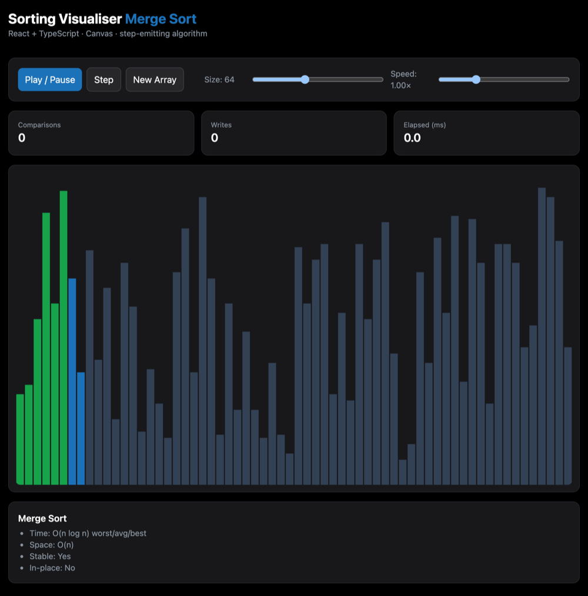
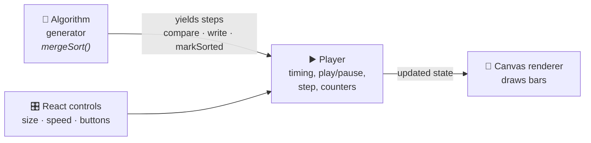

# Sorting Visualiser

An interactive, step-by-step visualisation of sorting algorithms, built with **React**, **TypeScript** and the **HTML Canvas**.

**▶ Live demo: [matthewmurden.github.io/sorting-visualiser](https://matthewmurden.github.io/sorting-visualiser/)**

<p align="center">
  
</p>

---

## Features

- **Play, pause or step** through the algorithm one operation at a time.
- **Adjustable array size** (8–150 bars) and **speed** (0.25×–3×).
- **Colour-coded bars:**
  - 🔵 blue: the bars being compared or written right now;
  - 🟢 green: bars already in their final position.
- **Counters** for comparisons, writes and elapsed time, shown when a run finishes.
- **A complexity card** for each algorithm (time, space, stability, in-place).

Currently implemented: **Merge Sort**.

---

## How it works

Each algorithm is written as a **generator function**. It doesn't sort in one go: it pauses (`yield`s) after every comparison or write and describes what just happened. A player pulls one step at a time and redraws the canvas.



This keeps the pieces separate:
- **Algorithms know nothing about drawing.** They just describe what they do, so adding a new one means writing a single generator.
- **The player controls time.** Speed, pausing and single-stepping all work the same for every algorithm.
- **The renderer only draws.** It turns the current array into coloured bars on the canvas.

```ts
// Every step an algorithm can emit
type Step =
  | { type: "compare"; i: number; j: number }
  | { type: "write"; i: number; value: number }
  | { type: "markSorted"; i: number }
  | { type: "done" };
```

---

## Project structure

```text
src/
├── algorithms/
│   └── merge.ts        Merge sort as a step-emitting generator
├── viz/
│   ├── player.ts       Steps through a generator: play/pause, speed, counters
│   ├── renderer.ts     Draws the array as bars on a high-DPI canvas
│   └── types.ts        Step, visualisation state and counter types
├── utils/
│   └── randomArray.ts  Random input generator
├── App.tsx             Controls, stats and layout
└── main.tsx            Entry point
```

---

## Running locally

**Requirements:** Node.js 20+

```bash
npm ci
npm run dev        # dev server at http://localhost:5173/sorting-visualiser/
npm run build      # type-check + production build into dist/
```

Every push to `main` is built and deployed to GitHub Pages automatically by [`.github/workflows/deploy.yml`](.github/workflows/deploy.yml).

---

## Roadmap

- More algorithms: quick sort, heap sort, insertion sort, bubble sort
- Algorithm picker, plus side-by-side comparison of two algorithms
- Counters that update live during a run (currently they update when the run finishes)

---

## Tech stack

React 18 · TypeScript · Vite · Tailwind CSS · HTML Canvas · GitHub Actions / Pages
